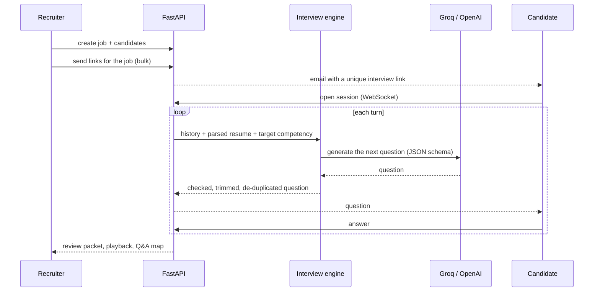

<div align="center">

# Kovidam AI Interview

**First-round technical interviews that run themselves and are easy to review.**

A recruiter adds a job and its candidates, then sends every candidate an interview link in one click.
An AI interviewer adapts its questions to each candidate's resume and answers. The recruiter then reviews the whole interview in a few minutes instead of sitting through it.

[](https://fastapi.tiangolo.com/)
[](https://nextjs.org/)
[](https://www.postgresql.org/)
[](https://redis.io/)
[](https://groq.com/)
[](docker-compose.yml)

[Live product](https://kovidam.co.in/) · [How an interview runs](#how-an-interview-runs) · [Quick start](#quick-start) · [API](#api) · [Docs](#documentation)

</div>

---

## Why it exists

First-round screens take a recruiter's whole day. A generic online test is easy to game and shows nothing about how a person thinks.
Kovidam AI Interview runs a **real conversation** grounded in the candidate's own resume, and hands the recruiter a compact review packet.

It is one of the two products behind [Kovidam](https://kovidam.co.in/). The other is [Kovidam Skill Graph](https://github.com/kartikeyajay2006/Kovidam-Skill-Graph), which builds the shortlist that these interviews start from.

## Features

| For recruiters | For candidates |
|---|---|
| Create jobs and add candidates, with optional parsed-resume JSON | One link, no account, opens straight into the interview |
| **Invite every candidate for a job in one click**, by email over SMTP | Questions follow up on *their* projects and answers |
| Dashboard with status, scores and analytics per job | Ask the interviewer to repeat or clarify at any time |
| **Review packet**: question-and-answer map, full playback and state trace | A short, focused session instead of a long test |
| Proctoring timeline of security events raised during the session | |

## How an interview runs



The engine (`backend/app/services/interview_engine.py`) does much more than "ask the LLM":

- **Resume-grounded questions.** It extracts sections from the resume and redacts contact details and other PII before any text reaches the model.
- **A competency ladder.** It works through an intro, main topics, follow-ups and precision probes, and tracks which ground has been covered.
- **Answer awareness.** It detects incomplete, off-topic and "please repeat" answers and responds to each one appropriately.
- **Guardrails on every question.** One question per turn, at most 36 words, no repeats (Jaccard similarity check), and no numbers the candidate never mentioned. That last check stops the model from inventing facts about the candidate.
- **Graceful fallback.** If the LLM is unavailable, deterministic fallback questions keep the interview going.

## Tech stack

| Layer | Technology |
|---|---|
| Backend | Python, FastAPI, SQLAlchemy 2, Alembic, asyncpg / psycopg 3, structlog |
| Realtime | WebSockets (`/ws/interviews/{id}`) |
| AI | Any OpenAI-compatible endpoint. Defaults to Groq or OpenAI `gpt-4o-mini`, with an optional fallback model |
| Data | PostgreSQL 16, Redis 7 |
| Frontend | Next.js (App Router), TypeScript, Tailwind CSS |
| Email | SMTP (TLS/SSL) |
| Infrastructure | Docker Compose with health-checked services |

## Quick start

**Prerequisites:** Docker with Compose, Node.js 20+.

```bash
git clone https://github.com/kartikeyajay2006/kovidam-AI-Interview.git
cd kovidam-AI-Interview

# 1. Configure (only once, so your keys are never overwritten)
[ -f backend/.env ] || cp backend/.env.example backend/.env
#    then set GROQ_API_KEY (or OPENAI_API_KEY) and your SMTP_* values in backend/.env

# 2. Start PostgreSQL, Redis and the API (health-checked)
docker compose up -d --build

# 3. Start the web app
cd frontend && npm install && npm run dev
```

| Service | URL |
|---|---|
| Web app | http://localhost:3000 |
| Recruiter dashboard | http://localhost:3000/dashboard |
| API + Swagger docs | http://localhost:8000/docs |

Check the backend:

```bash
curl -s http://localhost:8000/api/v1/health/live
curl -s http://localhost:8000/api/v1/health/ready
```

> [!NOTE]
> Real candidate email addresses are required. Placeholder domains such as `example.com` are rejected so that invites are never sent to addresses that do not exist.

## API

All routes are under `/api/v1`.

| Method | Endpoint | Purpose |
|---|---|---|
| `GET` | `/health/live` · `/health/ready` | Liveness and readiness probes |
| `POST` `GET` | `/jobs` | Create and list jobs |
| `POST` `GET` `DELETE` | `/candidates` | Manage candidates |
| `GET` | `/candidates/dashboard` | Candidate pipeline view |
| `POST` | `/interviews/send-link` | Invite one candidate |
| `POST` | `/interviews/send-links-for-job/{job_id}` | **Invite every candidate for a job** |
| `POST` | `/interviews/{id}/start` · `/end` · `/next-question` | Drive a session |
| `GET` `POST` | `/interviews/{id}/turns` | Conversation turns |
| `GET` `POST` | `/interviews/{id}/security-events` | Proctoring events |
| `GET` | `/interviews/{id}/review-packet` · `/playback` · `/qna-map` · `/state-trace` | Everything a reviewer needs |
| `GET` | `/interviews/review-feed` | Interviews waiting for review |
| `GET` | `/analytics/dashboard` | Recruiter analytics |
| `WS` | `/ws/interviews/{id}` | Realtime interview channel |

## Project structure

```text
backend/
  app/
    api/v1/endpoints/   recruiter, realtime interview and health routes
    services/           interview engine, resume parser, email service
    models/             SQLAlchemy entities
    schemas/            Pydantic request and response models
    core/               settings and structured logging
frontend/
  app/                  landing page, recruiter dashboard, candidate interview room
  components/           recruiter tables, review panel, interview launcher
docker-compose.yml      postgres + redis + backend with health checks
```

## Documentation

| Doc | What is inside |
|---|---|
| [ARCHITECTURE.md](ARCHITECTURE.md) | System design and data flow |
| [API_SPECIFICATION.md](API_SPECIFICATION.md) | Full endpoint reference |
| [TECH_STACK.md](TECH_STACK.md) | Technology choices and the reasons for them |
| [GETTING_STARTED.md](GETTING_STARTED.md) | Detailed setup |
| [DEVELOPMENT_ROADMAP.md](DEVELOPMENT_ROADMAP.md) | What comes next |

## Author

Built by **[Kartikeya Yadav](https://github.com/kartikeyajay2006)**, co-founder and AI engineer at [Kovidam](https://kovidam.co.in/).
[LinkedIn](https://www.linkedin.com/in/kartikeya2006/) · [Portfolio](https://kartikeya-portfolio-rx7w.vercel.app/)
